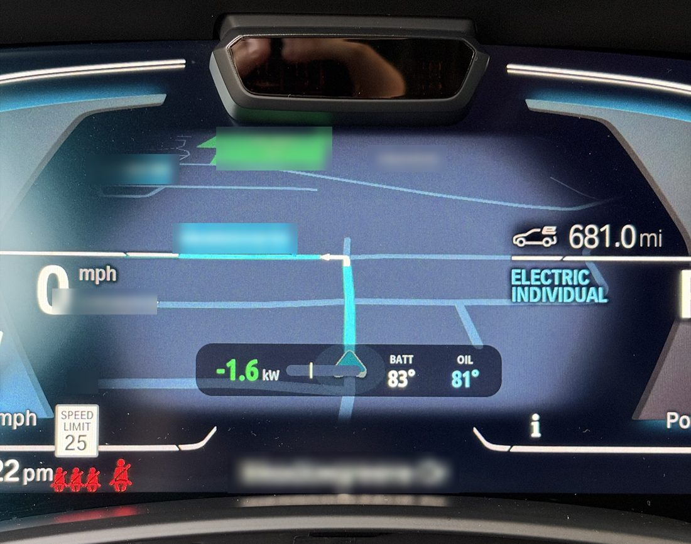
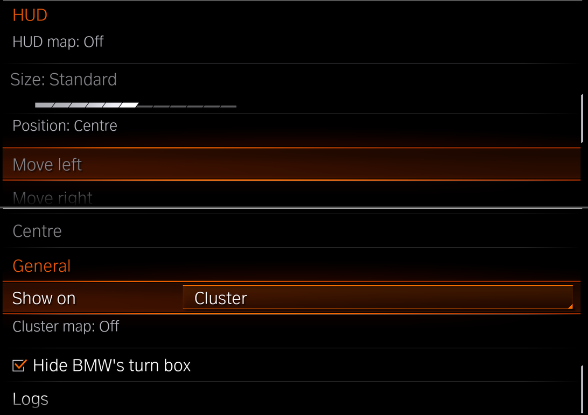
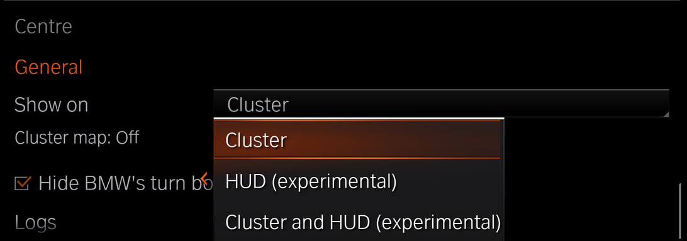
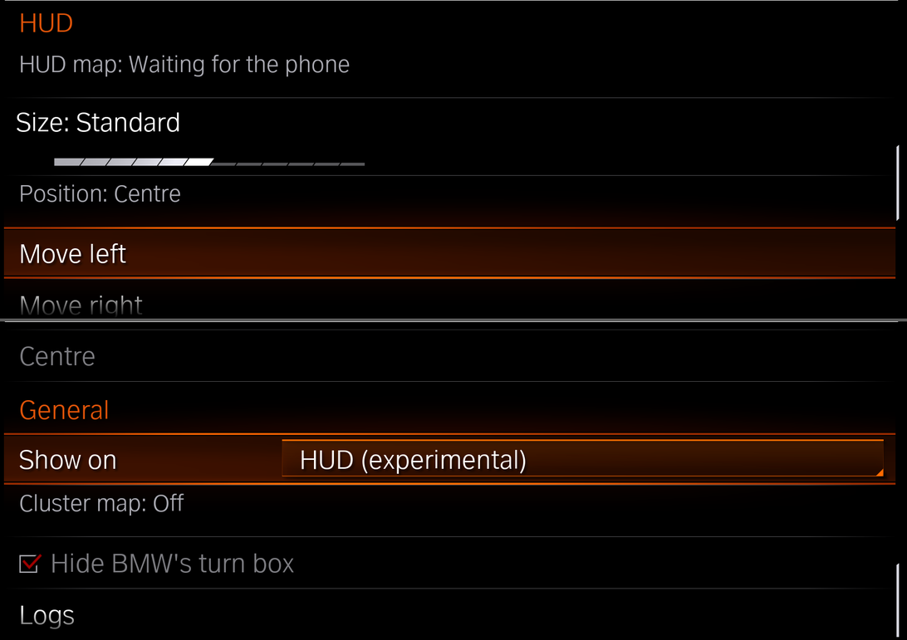
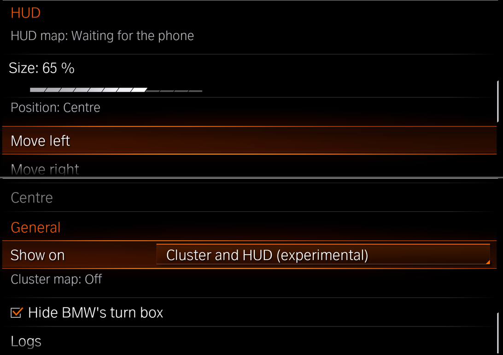
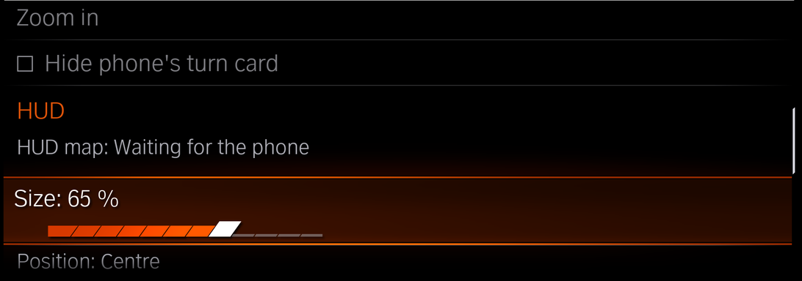
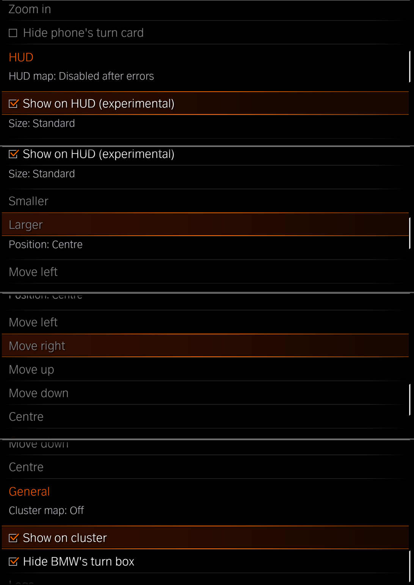

# Maps on cluster

Shows your phone's navigation map on the instrument cluster of a BMW with
iDrive 7. It can also show it on the head-up display (experimental).

- **CarPlay:** Waze, Apple Maps or Google Maps. During a route, Apple Maps
  and Google Maps also show their arrival-time card on the cluster.
- **Android Auto:** Google Maps.

Whether your car and its software are supported can differ for CarPlay and
Android Auto. The app's **Status** for each tells you.



## Install

1. In the [mgu Store](https://github.com/robertnisipeanu/mgu-store), install
   **Maps on cluster** from the `robertnisipeanu/idrive-apps` source (add the
   source if your Store doesn't list it). The Store installs everything it
   needs with it.
2. Restart the head unit when the Store asks.
3. In the car's settings, set **Instrument cluster > Central display area**
   to **Map view**.
4. Connect your phone and start navigation.

## What happens automatically

- Installing the app turns the map on for CarPlay and for Android Auto,
  each where your car supports it. You don't need to press anything.
- If a **Status** isn't `Patched` after the restart, see
  [If the map doesn't show](#if-the-map-doesnt-show).
- Updates keep it on.
- The map shows whenever your phone sends it. The app doesn't need to be
  open.

### Do I need to press Patch or Remove patch?

No. Leave them alone unless something is wrong.

- Press **Patch** when that phone type's **Status** says `Not patched`,
  `Update needed`, `Removed — head unit kept restarting` or
  `Removed — Android Auto crashed`. For any other Status, see
  [If the map doesn't show](#if-the-map-doesnt-show).
- **Remove patch** turns the map off for that phone type. Use it only if
  you want the map off, or to troubleshoot. It stays off, also after
  updates, until you press **Patch**.
- CarPlay and Android Auto are separate. If you only use CarPlay, leave
  Android Auto's buttons alone, and the other way round. Neither one
  affects the other.


## Settings

The app is in the head unit's display language.

**General**

- **Show on:** where the map shows: **Cluster** (the default), **HUD
  (experimental)**, **Cluster and HUD (experimental)** or **Off**. The
  change is immediate. **Off** shows BMW's own content on both.
- **Own settings for this driver:** ticked, the current driver profile
  keeps its own Show on, HUD size and HUD position.
- **Hide BMW's turn box:** ticked (the default), BMW's turn-by-turn box on
  the cluster is hidden while the map shows.
- **Logs:** opens the Logs page (see below).

**HUD**

- **HUD map:** what the HUD map is doing.
- **Keep HUD map over BMW's pop-ups:** unticked (the default), the map steps
  aside while BMW's media and list pop-ups show on the HUD. Ticked, it
  stays.
- **Size:** how wide the map is on the HUD.
- **Move left / Move right / Move up / Move down** and **Centre:** where the
  map sits on the HUD.

**CarPlay** and **Android Auto**

- **Status:** whether the map is on for that phone type.
- **Patch** and **Remove patch:** see
  [above](#do-i-need-to-press-patch-or-remove-patch).
- **CarPlay Wi-Fi** (CarPlay only): the Wi-Fi band your iPhone uses.
- **Zoom out / Zoom in** (Android Auto only): out shows more map, in shows
  bigger text.
- **Hide phone's turn card** (Android Auto only): hides Google Maps' own
  turn card at the top of the map.

**Restart head unit** shows when a change needs a restart. Press it to
apply the change.

## If the map doesn't show

| If you see | Do this |
|---|---|
| `Status: Not patched` | Press **Patch**. |
| `Status: Update needed` | Press **Patch**. |
| `Status: Patched after restart` or `Removed after restart` | Restart the head unit. If **Restart head unit** shows on the app's page, press it. |
| `Status: Removed — head unit kept restarting` | The patch was removed because the head unit kept restarting. Press **Patch** to try again. If it happens again, [report it](#logs-and-reporting-a-problem). |
| `Status: Removed — Android Auto crashed` | Android Auto's patch was removed after Android Auto crashed with it; Android Auto works without the map on the cluster. Use **Save logs** right away and [report it](#logs-and-reporting-a-problem). Press **Patch** to try again. |
| `Status: Untested version` | This software version of your car hasn't been tested. You can press **Patch** to try it. If the head unit keeps restarting, the patch is removed again by itself. |
| `Status: Not supported on this car` | Your car doesn't support the map for this phone type. |
| `Status: Unavailable` | If it stays once the head unit has fully started, [report it](#logs-and-reporting-a-problem). |
| `Status: Failed`, `Partly patched` or `Changed by another tool` | [Report it](#logs-and-reporting-a-problem). |
| `Cluster map: Off` | Check **Show on**: **Off** and **HUD (experimental)** keep the map off the cluster. Check that CarPlay's or Android Auto's Status is `Patched`. |
| `Cluster map: Waiting for the phone` | Connect your phone. |
| `Cluster map: Waiting for the phone's map` | Start navigation on your phone. |
| `Cluster map: Frozen` or `Stream lost` | Reconnect your phone: unplug it, or turn its Wi-Fi off and on. This can happen after you change the cluster's Central display area. |
| The map never shows on the cluster | Set **Instrument cluster > Central display area** to **Map view**. With Route preview or Assisted Driving View the cluster's own content takes the centre. |
| `Cluster map: Error` or `Unavailable` | [Report it](#logs-and-reporting-a-problem). |
| `HUD map: Disabled after errors` | Update **Cluster renderer** in the Store. The cluster map keeps working. |
| CarPlay audio cuts out and `CarPlay Wi-Fi: 2.4 GHz` | On your iPhone, turn Wi-Fi off and on. |

## Logs and reporting a problem

1. Open **Logs** on the app's page.
2. Press **Save logs**.
3. Turn on the car's Wi-Fi hotspot and connect your phone to it.
4. Scan the QR code on the Logs page, or open the **Address** it shows, and
   download the newest file.
5. Open an issue at
   [github.com/robertnisipeanu/idrive-apps/issues](https://github.com/robertnisipeanu/idrive-apps/issues):
   say what you saw, what you expected, your car model, and attach the file.

The file holds the map's logs and the head unit's recent messages. Your
car's VIN, network and device names and addresses are removed from it.

If you are asked for a capture: press **Start capture**, reconnect your
phone, wait until the problem shows, then press **Save logs**. The capture
stops by itself after 5 minutes.


## Remove

In the Store, remove the **Maps on cluster** app, then the **Maps on
cluster** tool. The original CarPlay and Android Auto come back at the next
head-unit restart.

## For developers

The map service and the patches are in
[waze-on-cluster](../../native/waze-on-cluster).

### Languages

The app is in the head unit's display language, every one the iDrive 7 HMI
offers: English (UK, US), German, Dutch (also Flemish), Danish, Swedish,
Norwegian, Finnish, Polish, Czech, Slovak, Slovenian, Hungarian, Romanian,
French (France, Canada), Italian, Turkish, Spanish (Spain, Latin America),
Portuguese (Portugal, Brazil), Greek, Russian, Ukrainian, Indonesian,
Vietnamese, Japanese, Korean, Simplified Chinese (also Cantonese
simplified), Traditional Chinese (also Cantonese traditional), Arabic,
Hebrew and Thai. A word a language has no translation for is English.

A language is one file, `locales/<code>.json`: the HMI's languages it is
for (`CommonTypes.Language`), its RHMI text files (named as the oap-sdk
names those languages) and its words, each keyed by the English (`{0}`,
`{1}` stand for the values):

```json
{ "hmiLanguages": ["DEUTSCH"], "rhmiTexts": ["de_DE"],
  "words": { "Status: {0}": "Status: {0}", "Save logs": "Logs speichern" } }
```

`node tools/build.js` writes them into the app (`src/locales.js`) and into
the RHMI text files, which hold the tile's name and the Logs page's title.
`node tools/test_i18n.js` checks that every language has every word with
the same `{n}`, and every HMI language its text file.

### Screenshots

| | |
|---|---|
| The top of the page: General |  |
| Show on: Cluster (the default) |  |
| Own settings for this driver, ticked |  |
| Show on, open |  |
| Show on: HUD (experimental) |  |
| Show on: Cluster and HUD (experimental) |  |
| The HUD map's size, the slider turned |  |
| Keep HUD map over BMW's pop-ups: unticked (the default) and ticked |   |
| HUD disabled after errors |  |
| CarPlay |  |
| Android Auto |  |
| Android Auto alone patched, the cluster map showing |   |
| Android Auto not supported |  |
| A change waiting for a restart |   |
| The Logs page |  |

### Build and test

```sh
node tools/test_control.js           # the socket client against fake sockets
node tools/test_page.js              # the page against a fake SDK and HMI
node tools/test_profiles.js          # the driver profiles against fake sockets and SessionManager
node tools/test_i18n.js              # every language: its words, placeholders, RHMI text files
node tools/build.js                  # robertn_waze_cluster@<version>.src.tgz
node tools/build.js --sdk <donor>    # also robertn_waze_cluster@<version>.tgz
```

The app ships as a source package (`mgu-app.json`; `"build": "unit"` in the
catalog). The repository carries no oap-sdk, which is BMW's: the head unit's
deploy tool links the app against the unit's own oap-sdk. To build the OAP
tgz locally, pass a donor bundle with `--sdk` (or `MGU_SDK_DONOR`), for
example the one `mgu-deploy.sh sdk-donor` takes from the unit. The tests
need no donor.

`node tools/fakes.js <render.sock> <patch.sock>` runs both fakes by hand;
Enter starts or stops a fake CarPlay stream.

| Path | |
|---|---|
| `src/robertn_waze_cluster.js` | the app |
| `src/i18n.js`, `src/locales.js` | the words in the display language; the languages, written from `locales/` |
| `locales/<code>.json` | a language's words (Languages) |
| `src/waze_cluster_control.js` | the render and patch socket clients and the status logic |
| `src/logs_control.js` | the logs socket client |
| `src/profile_sync.js` | the driver profile in use and its own map settings |
| `src/qr.js`, `src/qrcodegen.js` | the QR code PNG; Project Nayuki's generator (MIT, `LICENSE-qrcodegen.txt`) |
| `tools/` | build, fakes, tests, icon |
| `package/` | the package tree (manifest, RHMI UI, config, CHANGELOG) |

### License

GPL-3.0-or-later (`LICENSE`). Third-party files keep their own licenses.
